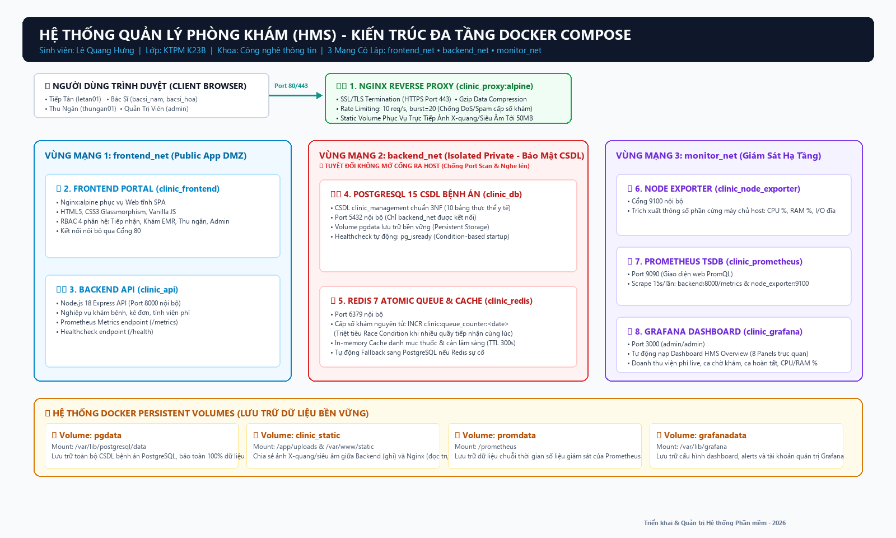

# HỆ THỐNG QUẢN LÝ PHÒNG KHÁM ĐA TẦNG (CLINIC MANAGEMENT SYSTEM - HMS)
## ĐỒ ÁN MÔN HỌC: TRIỂN KHAI VÀ QUẢN TRỊ HỆ THỐNG PHẦN MỀM

* **Sinh viên:** Lê Quang Hưng
* **Lớp:** KTPM K23B
* **Khoa:** Công nghệ thông tin
* **Trường:** Đại học Công nghệ Thông tin và Truyền thông
* **GitHub Repository:** [https://github.com/DTC245180036/Trienkhai_DTC245180036_LeQuangHung](https://github.com/DTC245180036/Trienkhai_DTC245180036_LeQuangHung)

---

## I. TỔNG QUAN KIẾN TRÚC HỆ THỐNG (DOCKER COMPOSE)



Hệ thống được đóng gói và điều phối hoàn toàn qua **Docker Compose** bao gồm 8 container dịch vụ độc lập, chia làm 3 vùng mạng cách ly:

1. **`clinic_proxy` (Nginx:alpine):** Đóng vai trò Reverse Proxy biên, lắng nghe cổng 80 (HTTP) và 443 (HTTPS), áp dụng Rate Limiting `rate=10r/s burst=20`, nén Gzip, phục vụ trực tiếp file ảnh X-quang/siêu âm dung lượng tới 50MB qua Docker volume tĩnh.
2. **`clinic_frontend` (Nginx:alpine):** Cung cấp giao diện Web Portal SPA hiện đại với phân quyền RBAC 4 vai trò y tế, bộ lọc thời gian khám theo ngày linh hoạt và giám sát tài chính live.
3. **`clinic_api` (Node.js 18 Alpine):** Backend API xử lý nghiệp vụ khám bệnh, kết nối CSDL, xuất OpenMetrics tại `/metrics` và healthcheck tại `/health`.
4. **`clinic_db` (PostgreSQL 15 Alpine):** Cơ sở dữ liệu bệnh án 10 bảng chuẩn hóa 3NF, lưu trữ bền vững trên volume `pgdata`, bảo vệ nghiêm ngặt trong mạng nội bộ `backend_net` (cấm map port ra ngoài).
5. **`clinic_redis` (Redis 7 Alpine):** Bộ nhớ đệm và cấp số thứ tự nguyên tử `INCR clinic:queue_counter:<date>` chống Race Condition và cache danh mục y tế.
6. **`clinic_prometheus` (Prometheus TSDB):** Thu thập metrics định kỳ 15s/lần từ ứng dụng và phần cứng máy chủ.
7. **`clinic_grafana` (Grafana):** Bảng điều khiển giám sát trực quan hóa 8 panels, tự động nạp provisioning Datasource & Dashboard *HMS Overview*.
8. **`clinic_node_exporter` (Prom/Node-Exporter):** Trích xuất thông số phần cứng máy chủ host (CPU, RAM, Disk I/O).

---

## II. BẢNG TỔNG HỢP TÀI KHOẢN VÀ CỔNG TRUY CẬP

| Dịch vụ / Phân hệ | Đường dẫn truy cập | Tài khoản | Mật khẩu | Quyền hạn & Chức năng nghiệp vụ |
| :--- | :--- | :--- | :--- | :--- |
| **Cổng Tiếp Tân** | [http://localhost](http://localhost) | `letan01` | `123456` | Tiếp nhận bệnh nhân, kiểm tra hợp lệ CCCD & SĐT, cấp số khám tự động qua Redis, in phiếu số |
| **Bác Sĩ Khám (P.102)** | [http://localhost](http://localhost) | `bacsi_nam` | `123456` | Mời bệnh nhân vào phòng, khám EMR, nhập sinh hiệu, chẩn đoán, kê đơn theo vỉ/hộp, tạo viện phí |
| **Bác Sĩ Khám (P.201)** | [http://localhost](http://localhost) | `bacsi_hoa` | `123456` | Khám Tai Mũi Họng, chỉ định CLS & nội soi, kê đơn thuốc chuẩn dược |
| **Quầy Thu Ngân** | [http://localhost](http://localhost) | `thungan01` | `123456` | Thu tiền viện phí (Tiền mặt / QR Pay), in phiếu thu, xuất bảng kê chốt ca trực ra file Word (.doc) |
| **Quản Trị / DevOps** | [http://localhost](http://localhost) | `admin` | `123456` | **Chế độ Giám sát toàn quyền:** Giám sát hàng đợi tiếp đón, tiến độ phòng khám, đối soát tài chính, xem sơ đồ hạ tầng, bắn tải test DoS, xuất báo cáo Word. *(Khóa tác nghiệp thu tiền và cấp số để đảm bảo tính minh bạch kiểm toán)* |
| **Grafana Monitoring** | [http://localhost:3000](http://localhost:3000) | `admin` | `admin` | Giám sát 8 metrics panel (Doanh thu live, CPU, RAM, Network I/O) |
| **Prometheus TSDB** | [http://localhost:9090](http://localhost:9090) | *(Nội bộ)* | *(Nội bộ)* | Truy vấn PromQL, kiểm tra Scrape Targets |
| **API Healthcheck** | [http://localhost/api/health](http://localhost/api/health) | Công khai | Không | Kiểm tra trạng thái DB, Redis và Uptime |
| **API Metrics** | [http://localhost/api/metrics](http://localhost/api/metrics) | Nội bộ | Không | Cung cấp dữ liệu theo chuẩn OpenMetrics |

---

## III. HƯỚNG DẪN KHỞI CHẠY HỆ THỐNG (1-CLICK)

File `README.md` được biên soạn chi tiết, hướng dẫn cụ thể cách thức clone repository, cấu hình biến môi trường và chạy lệnh `docker compose up -d` để khởi chạy toàn bộ hệ thống.

### Yêu cầu tiên quyết:
* Máy tính đã cài đặt **Docker Desktop** (Engine đang chạy).
* Công cụ dòng lệnh: **Git**, **PowerShell** (Windows) hoặc **Terminal** (Linux/macOS).

### Các bước khởi chạy chi tiết:

#### 1. Clone repository từ GitHub
```bash
git clone https://github.com/DTC245180036/Trienkhai_DTC245180036_LeQuangHung.git
cd Trienkhai_DTC245180036_LeQuangHung
```

#### 2. Cấu hình biến môi trường
Tạo tệp cấu hình `.env` từ tệp mẫu `.env.example` để thiết lập thông tin kết nối CSDL và cổng dịch vụ:
* **Trên Windows (PowerShell / Command Prompt):**
```powershell
copy .env.example .env
```
* **Trên Linux / macOS:**
```bash
cp .env.example .env
```
> **Ghi chú cấu hình:** Tệp `.env` đã được thiết lập mặc định an toàn cho môi trường chạy thử nghiệm:
> * `POSTGRES_DB=clinic_management`
> * `POSTGRES_USER=clinic_admin`
> * `POSTGRES_PASSWORD=YourSecurePasswordHere!`
> * `PORT=8000`

#### 3. Chạy lệnh khởi chạy toàn bộ hệ thống
Chạy lệnh `docker compose up -d` để tải các image, build dịch vụ và khởi động đồng thời cả 8 container chạy ngầm trong nền:
```bash
docker compose up -d --build
```
*(Hoặc click đúp chuột vào file `start.bat` trên Windows để khởi chạy tự động chỉ với 1-click).*

#### 4. Kiểm tra trạng thái các container
Kiểm tra đảm bảo toàn bộ 8 container đều đang chạy ổn định (`Up` hoặc `Up (healthy)`):
```bash
docker compose ps
```

---

## IV. KỊCH BẢN DIỄN TẬP PHỤC HỒI THẢM HỌA (DISASTER RECOVERY)

Khi xảy ra sự cố xóa nhầm bảng dữ liệu bệnh nhân, thực thi chuỗi lệnh phục hồi trên PowerShell:

```powershell
# Bước 1: Sao lưu dữ liệu hiện tại
.\scripts\backup_db.ps1

# Bước 2: Giả lập thảm họa xóa bảng bệnh nhân
docker exec -i clinic_db psql -U clinic_admin -d clinic_management -c "DROP TABLE patients CASCADE;"

# Bước 3: Kiểm tra bảng đã mất
docker exec -i clinic_db psql -U clinic_admin -d clinic_management -c "SELECT count(*) FROM patients;"

# Bước 4: Chạy script khôi phục thảm họa tự động
.\scripts\restore_db.ps1

# Bước 5: Kiểm tra xác nhận dữ liệu bệnh nhân đã được phục hồi 100%
docker exec -i clinic_db psql -U clinic_admin -d clinic_management -c "SELECT count(*) FROM patients;"
```

---

## V. CÁC BIỆN PHÁP GIA CỐ BẢO MẬT & QUY TẮC NGHIỆP VỤ Y TẾ
1. **Network Isolation:** Phân chia 3 vùng mạng bridge (`frontend_net`, `backend_net`, `monitor_net`). PostgreSQL cấm map port ra ngoài.
2. **Bảo mật Biến môi trường:** Tệp `.env` được bảo vệ và loại trừ khỏi Git qua `.gitignore`.
3. **Healthcheck Condition:** Backend chỉ khởi động khi PostgreSQL sẵn sàng qua lệnh `pg_isready`.
4. **Persistent Volumes:** Dữ liệu CSDL lưu tại `pgdata` và ảnh lưu tại `clinic_static`, không bị mất khi restart container.
5. **Nginx Rate Limiting:** Giới hạn 10 req/s burst 20, chống spam cấp số khám và DoS.
6. **RBAC Enforcement (Chặt chẽ 2 lớp UI & API):**
   * Quản trị viên (`ADMIN`) có quyền giám sát toàn bộ luồng, kiểm toán hóa đơn, xem hạ tầng và xuất báo cáo Word; nhưng **bị khóa các thao tác tác nghiệp** (cấp số, khám bệnh, thu tiền).
   * Lễ tân (`RECEPTIONIST`) chỉ được cấp số và tiếp nhận bệnh nhân.
   * Bác sĩ (`DOCTOR`) chỉ được khám và kê đơn cho bệnh nhân được phân công; bắt buộc phải mời bệnh nhân vào phòng (`IN_PROGRESS`) trước khi lưu bệnh án.
   * Thu ngân (`CASHIER`) phụ trách thu tiền viện phí (tiền mặt/QR) và xuất biên bản chốt ca.
7. **Quy chuẩn dữ liệu y tế & Chống xung đột định danh:**
   * Bắt buộc họ tên tiếng Việt đầy đủ (ít nhất 2 từ), CCCD đúng 12 chữ số, SĐT đúng 10 số.
   * Chặn trùng số CCCD hoặc SĐT nhưng khác họ tên để tránh xung đột hồ sơ bệnh án.
   * Kê đơn thuốc theo đơn vị chuẩn y tế bệnh viện: Vỉ, Hộp, Chai/Lọ.
8. **Xuất báo cáo tài chính chuẩn Microsoft Word (.doc):**
   * Hỗ trợ xuất biên bản chốt ca thu ngân và báo cáo doanh thu phòng khám ra file Word (.doc) khổ A4 chuẩn hóa có chữ ký kiểm toán.

